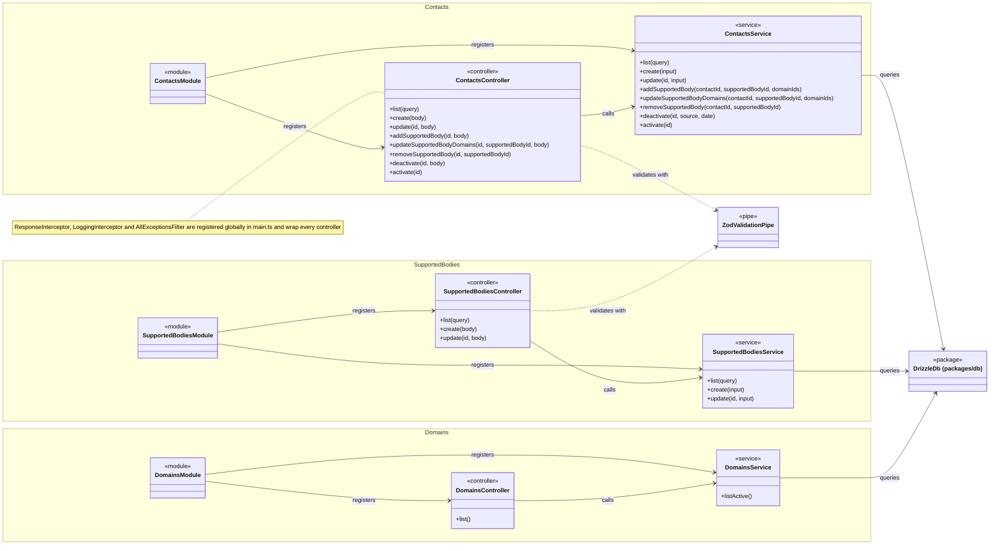

# Class Diagram: ה-API

נוצר מ-`apps/api/src` ב-2026-10-22. אין לערוך ידנית: מרעננים בעזרת הסקיל `expertise-diagrams`.

## מה שהתרשים לא מראה

- רק פעולות ציבוריות מופיעות. פונקציות עזר פרטיות, כמו `loadLinks` ו-`getDto`, הושמטו.
- ה-`ResponseInterceptor`, ה-`LoggingInterceptor` וה-`AllExceptionsFilter` נרשמים גלובלית ב-`main.ts` וחלים על כל ה-controllers. לכן הם מופיעים רק בהערה, ולא עם חץ לכל controller.
- מודולי `health` ו-`telemetry` לא נכללים: הם תשתית ולא חלק ממבנה הנתונים של הפרויקט.
- ה-controllers לא מתחברים ל-`DrizzleDb`: רק ה-services. זה הכלל של ארבע השכבות, ואם יופיע חץ כזה, זו הפרה.
