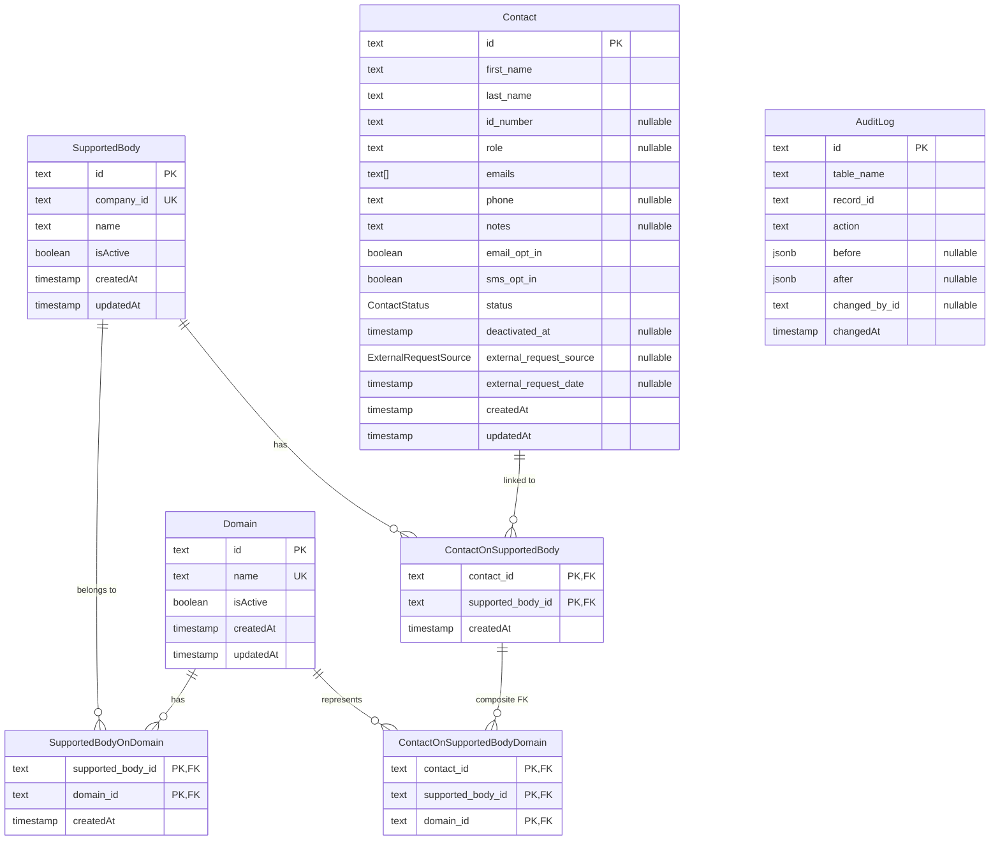

# ERD: מסד הנתונים

נוצר מ-`packages/db/src/schema/index.ts` ב-2026-10-22. אין לערוך ידנית: מרעננים בעזרת הסקיל `expertise-diagrams`.

## מה שהתרשים לא מראה

- איש קשר אף פעם לא נמחק: "מחיקה" היא `status = INACTIVE`.
- התחומים של איש קשר מול גוף נתמך חייבים להיות תת-קבוצה של התחומים של הגוף עצמו. זה נאכף ב-`ContactsService`, ואין לזה מפתח זר בסכמה.
- לאיש קשר אין `domainId` ישיר: הוא מגיע לתחום רק דרך הגוף הנתמך שאליו הוא מקושר.
- `AuditLog` קיימת בסכמה, אבל כרגע שום דבר לא כותב אליה.
- `Domain` היא טבלה ולא enum, כדי שאפשר יהיה להוסיף ולשנות תחומים בלי migration.
